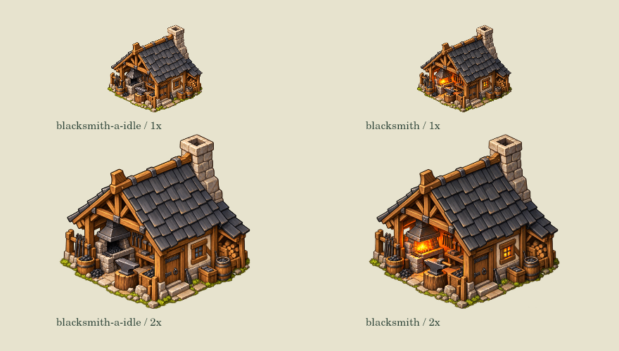

# 铁匠两态：保留原加工图，冷炉不冒充生产

关联 #87；基线 main `65e02091748141c1ea4dd0d388592b67a279257d`，2026-10-23。

本片不重画原优质建筑：原 `assets/buildings/blacksmith.png` 完整保留作为真实加工状态，新增暖色手绘冷炉待工图。待工炉膛冷炭、工具归位、冷窗；这不是全局换色。图片只有真实 smith process 批次、实料、工人到实际门口且仍在工作时切回原燃炉图。分配工人、累计产量、取料/返程/送成品、缺料不能亮炉。全局暂停保留已接批次画面，既有动效时间冻结。

两图 source 512×469、脚点 (256,469)，以原 1.06 倍建筑宽度预算绘制；地基、碰撞、道路、工作点和存档不变。原有工作标识和火花锚点仍复用。缺少/损坏可选冷炉图时回退旧图，缺原图仍保留既有程序化回退；不把回退画面当两态素材已加载成功。

## 素材来源与边界

- `idle-source.png`：内置 image_gen 基于原 blacksmith.png 的 precise-object-edit 原始透明输出，1310×1200。无外部付费模型/API调用。
- `prompt.txt`：完整编辑要求；`provenance.json`：源/运行时/保留图哈希。
- `tools/export-blacksmith-art.cjs`：只做 Canvas 512×469 技术导出，保留 alpha，不手工变色或变形。
- 图像编辑并非局部像素锁定，外围 RGBA/alpha 与原图也有变化；不能称逐字节或逐像素保留。原生并排检查建筑布局和脚点无显著跳动，炉区区别在 1× 可辨。

## 实际检查

- `tests/blacksmith-art.js`：7组，真实取料→加工→送成品，铁/钢配方，暂停/目标/用工变化，失效/远离/死亡/实料检查，状态/RNG纯读，校准与缺图回退。
- `building-activity.js` 25组、`blacksmith-arrival.js` 5组、`woodcutter-art.js` 3组、`focused-building-state.js` 9组和 smoke 226项通过。
- `tools/render-blacksmith-scene.cjs`：16张实际生产Canvas帧（无人/分派/取料/加工/暂停/停止/缺料/冬季 × 1×/2×），全部保存数据不变；另有同脚点并排图。
- 既有 `blacksmith-input.js` 前4组通过，第5组因平地夹具清水面但保留主河航道而触发“主河航道不是水面”；未修改基线也同样失败，不把中断后测试算通过，不混入本片修改。
- Node 本轮 24.19.0。离线原生Canvas不是浏览器或手机验收；不以手机试玩阻塞开发/合并。未部署。

局部两态交付不关闭 #87，不代表其他工坊、地图职业造型或整套 A 视觉已完成。
