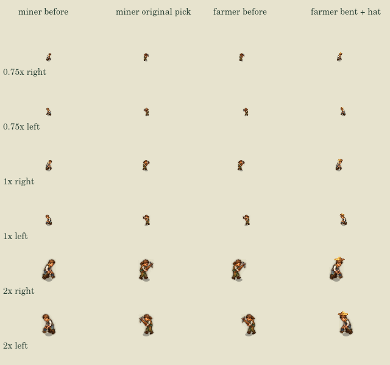
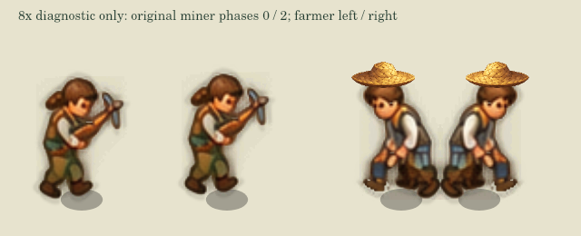

# 两种现场职业表现：原镐姿与农夫草帽

关联 #87 原有两职业小片；不重做已接的木工斧头，不把 UI 头像算成地图职业造型，不重画原人物脸和身体。

实际查看原素材发现旧注释不准确：`adult_work_1` 是举镐姿，`adult_work_0` 是弯腰劳作，`adult_carry_idle` 才是抱筐姿。因此本片不把新镐叠在原人脸上，也不重复生成已有优质动作：

- 矿工/采石工：真实有效矿产任务、储量与现场劳动时，复用原 `adult_work_1` 举镐帧。没有新增工具库存，也不将已有PNG说成新美术。
- 农夫：真实当前年份/作物的播种或收割现场，复用原弯腰劳作帧并戴新增宽檐草帽，不继续让农夫举镐。不是只按分派岗位给全部人戴帽；缺帽图安全保留旧表现。
- 新增资产只有一张原创透明草帽。原身体/人脸/动作PNG全部未改；帽随既有sx/bodyY/facing定位镜像，不改变脚点和前后遮挡。
- 有效本人/楼/岗位成员、劳动剩余、实际现场均须匹配；儿童/学生/死亡/旧对象/无效任务不显示。农夫允许既有同作物累积收成，不把非作物货物当现场农活。室内/学校/医院/教堂/隧道仍沿原绘制早退隐藏。
- 使用原animT和暂停时钟，不新增职业、计时、RNG、身份字段、存档、经济或攻击玩法。

## 来源与导出

内置 image_gen 生成独立原创草帽，不描摹外部游戏资产。源PNG、完整提示词及哈希保留同目录；`tools/export-profession-art.cjs` 只按alpha>0取完整内容边界，再原比例缩到128px宽，未手工改绘。`export.json` 记录原尺寸/裁剪/导出尺寸。新镐试稿因重复已有原图且叠加会遮脸而未采纳、不发到仓库，不能计入交付。

## 验证边界

实际任务、纯读状态、原生尺度、左右方向、停工、缺图与全场景遮挡分别验证；离线生产Canvas不宣称浏览器或手机通过。两职业不代表地图男女/老人/全职业身份外观完成，#87仍开放。未部署、未新调用外部付费API、未更改权限。

## 本轮实际结果

职业专项9组、citizen-presentation22、woodcutter-art3、smoke226、art-combination和art_assets179 PNG/全建筑携物检查通过。第9组验证坏尺寸帽或缺弯腰body不切帧/不画悬空帽。独立审查确认原身体PNG与模拟源码未改。

`tools/render-profession-scene.cjs` 从真实矿井/农田任务步进到现场，生成24个左右方向×0.75/1/2原生对照、4个8×放大诊断、停工图和全生产场景before/working；加 `rear` 参数从后侧真实寻路到被建筑遮挡的工作点，身体和帽都按原排序遮挡。全部保存数据不变。8×只是附件定位诊断，不能当原生可读证据。

原生二眼检查通过：矿工使用原举镐姿，农夫帽按弯腰头位贴合，脸可见。只采用这次聚焦修正，不另铺新人物全套。
