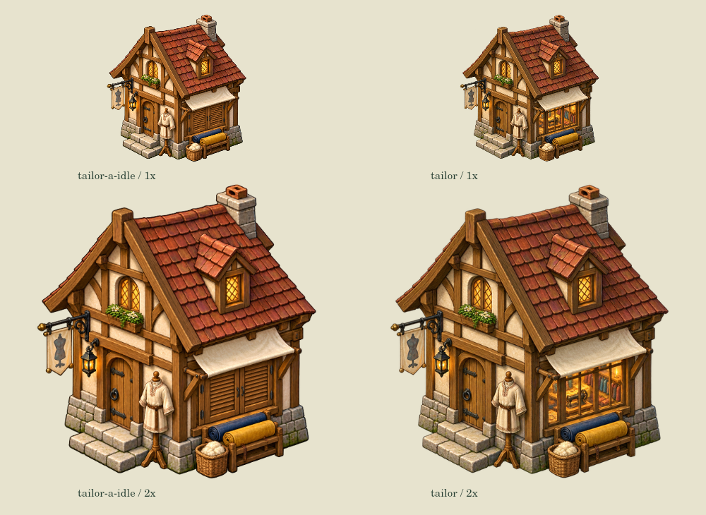

# 裁缝工坊：工作窗随真实衣料加工开合

关联 #87，接续 PR #162 的铁匠两态，不关闭整套 A 视觉目标。

保留原 `assets/buildings/tailor.png` 作为真实加工状态；新增透明待工图只将右下缝纫工作窗以木百叶关闭。实际左门、招牌、衣架、布卷和篮筐保留，不把陈设有无当库存数量。不改变建筑脚印、门口或通行。

只有 `buildingProcessingWorker` 验证的现场有效 tailor process 批次、同一 inputCargo、coatInput 和 exact consume 内容一致时展示原开窗图。分派、取料、返工坊/送成品、暂停接新单、病假/死亡、伪造或缺少衣料不能冒充加工。全局暂停保留既有真实批次，动效沿原时钟冻结；basic/warm 锁定批次不被下一批配方改变。

## 素材与尺度

- `idle-source.png`：内置 image_gen 根据原 tailor 图 precise-object-edit 输出，1221×1289；完整要求见 `prompt.txt`。
- 运行时导出 `assets/a-style/tailor-a-idle.png`，512×540；`tools/export-tailor-art.cjs` 只作 Canvas 技术缩放，保留透明通道。
- 原加工图完整不变。source脚点(256,540)、宽度预算1.04与原图一致，原工作标识/锚点保留。
- 哈希见 `provenance.json`。生成的待工图不是像素锁定局部补丁，外围像素/alpha亦变化，不能声称逐像素不变。

## 检查范围

新 `tests/tailor-art.js` 8组正式实现通过：实际取料/加工/送货，basic/warm批次与换下一配方，暂停/目标/用工，死亡/离场/无货/错货，RNG/存档纯读，双态校准和缺图回退。缺可选待工图回退旧图，不声称未加载时也能显示两态。

`tools/render-tailor-scene.cjs` 复建16张生产Canvas状态帧和同脚点1×/2×对比；这是离线原生Canvas，不是浏览器或物理手机验证，不以手机试玩作开发合并门槛。无生产部署、外部付费API、存档/玩法变化。

本片只补裁缝工作状态；酒馆酿造与接待、地图职业外观仍分别接续，不等同整套完成。

专项独审与 `building-activity` 25组通过；`smoke` 226项、`blacksmith-art` 7组通过。既有 `tailor-input` 前7组通过，第8读档因旧平地夹具清空水面但保留主河航道报错；在未加tailor改动的smith基线上同位置复现，后续未执行不计通过。Node24.19.0。并排工具断言返回图宽必须等于真实建筑占地宽×zoom×BUILD_SPR_W，避免固定宽度误标原生比例。
