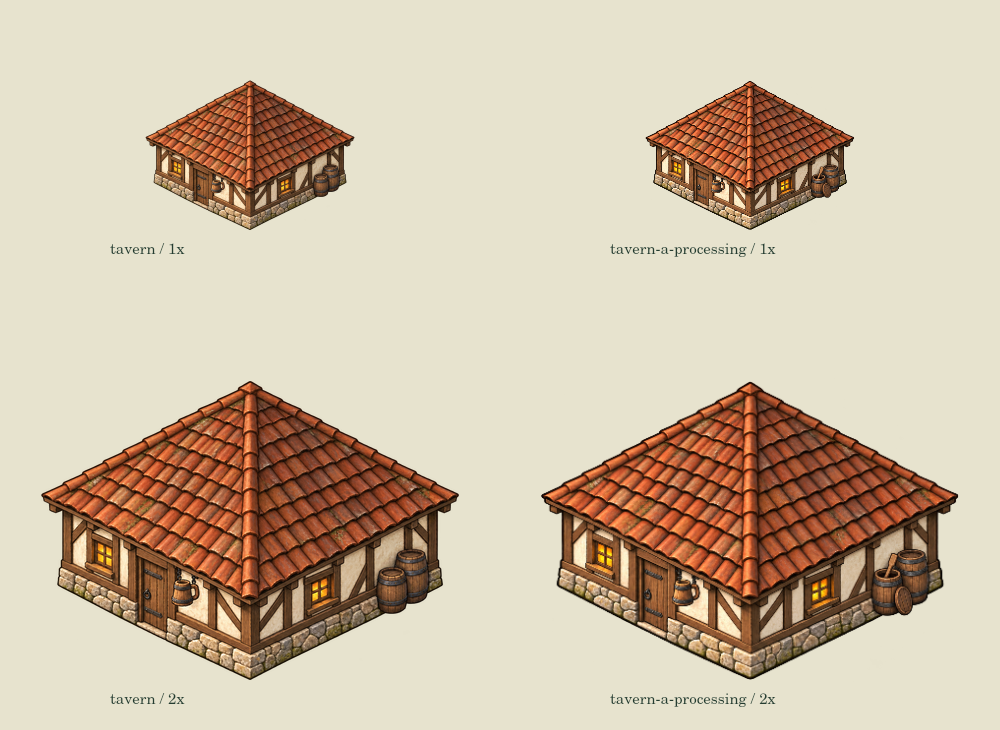

# 酒馆：接待不等于酿造

关联 #87，接续铁匠与裁缝状态小片。保留原 `assets/buildings/tavern.png` 作为空闲/接待态；仅实际酿造批次显示近侧桶开盖、暗桶口和短木搅拌桨。两只桶仍在原位，桶盖靠原桶，没有新增桶/粮袋/库存或人。它是工作状态图示，不声称人物实际在外桶旁劳动；真实入口、路径和加工点不变。

`G.tavernArtName` 复用已有 `buildingProcessingWorker`：真实 brew/process、现场/健康、实际配方类型数量的 brewIngredient 及口粮储备均有效才显示加工图。hosting即使员工在馆且有酒仍用原图，取料/返程/送仓不冒充酿造。已接配方不随下一配方改变；全局暂停保留真实批次静态图。未增加数据模型、存档或经济规则。

## 素材与校准

- `processing-source.png` 是内置 image_gen 对原 tavern 的透明 precise-object-edit 输出，1484×1060；完整 prompt 与 SHA256 见同目录记录。
- `tools/export-tavern-art.cjs` 仅缩放为448×320运行时PNG，不手工重绘/重色。
- 原图绘制宽预算7/6、源脚点(224,320)。新图不是像素锁定局部补丁；直接相同画布锚会略放大上浮，故未直接采纳。
- 校准新图 `anchor=[223.5,316]`, `span=(448/(7/6))*425/418`。旧/新alpha>16轮廓宽418/425，高299/304；原屋顶峰y21、新y12，前石基底旧y319、新y315。统一实际脚点后原生屋顶/底边纵向误差<0.01px，横向峰/底<0.5px；原生图独审无明显整体跳动。局部瓦片/纹理不同，不声称像素完全一致。
- 工作特效使用原图世界锚/尺寸，不让新源图校准把效果挪走。点击/占地未变。
- 并排工具按真实3×3占地和可见轮廓跨度断言1×/2×尺度，不以固定128宽冒充原生。

## 实际验证与边界

正式 tavern-art 11组专项覆盖三配方真实取料/加工/实运，hosting不等于brewing、口粮下降/疾病、锁定批次与换配方、离场/死亡/完成、缺料、RNG/存档纯读及缺图回退。原tavern图未改。

16张生产Canvas状态图（含真实到岗hosting）及1×/2×并排实际生成，保存数据均不变。smoke226、smith7、tailor8专项通过。既有 tavern.js 前10组通过，第11主河平地夹具读档报错在tailor基线同位置复现；模拟/存档源码逐字节未变，后续未执行不计通过。

Node24.19.0。离线生产Canvas不是浏览器/物理手机证明，手机试玩不作本片开发合并门槛。未部署，未新调用外部付费API，未更改权限。工坊状态完善不关闭#87或冒称整体A视觉/地图职业外观完成。

第11组独立新增测试截取真实绘制调用，两态在实际3×3与合成2×3/4×2几何夹具中保持原效果尺寸/脚点/世界锚；合成尺寸仅测renderer，不宣称可建玩法。独立源码/原生图复审无剩余本片阻断。
