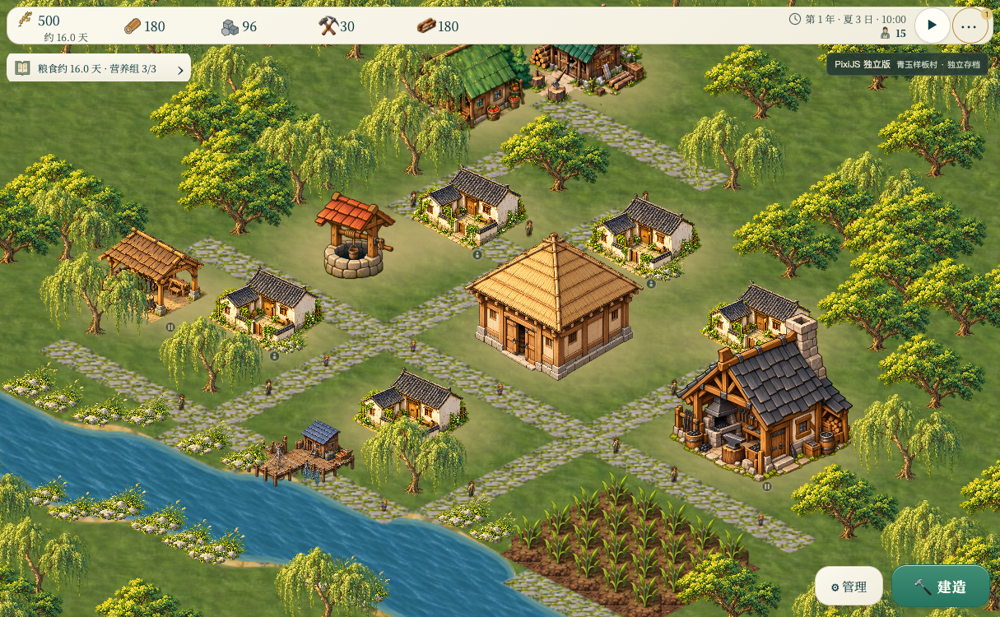
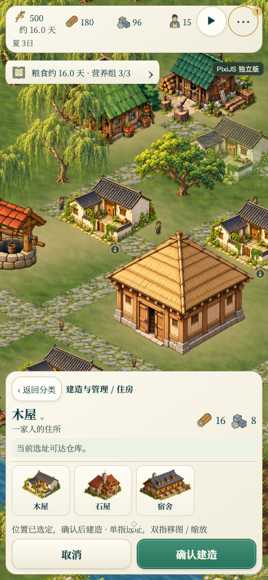

# PixiJS 独立版 · 青玉河湾村

入口为 `pixi.html`，分支为 `codex/pixijs-standalone`。在本工作树根目录运行：

```sh
python3 dev-server.py 8624
```

打开 <http://127.0.0.1:8624/pixi.html>。首次进入载入青玉样板村，并暂停模拟；右上角 ▶ 继续经营。<http://127.0.0.1:8624/pixi.html?start=classic> 保留普通开局入口。原 `index.html` 仍使用 Canvas 2D。



## 美术与场景

以 [A 图](../ui-reference/selected-a.png) 的白墙灰瓦、暖色粮仓、柳树、河岸石草和纸色青玉界面为方向。新增透明院落与河岸组合素材，保留源图，用源像素锚点校准落地位置。建筑工具卡和放置预览使用对应素材；低矮装饰参与深度排序。院落地表贴花烘焙进地形缓存，跨格连续绘制。

样板村是作者布置的**可玩初始存档**，含 13 栋建筑、5 个家庭、15 位居民、已播农田和较充足的初始库存。它不是自然游玩到夏季的记录，也不是整幅背景画。建筑、作物、道路和树木仍属于游戏世界，居民使用现有寻路、岗位、搬运和生产系统。

布局来源是 `assets/pixi/village-plan.json`。修改布局后用 `node tools/build-pixi-village.cjs` 重建 `assets/pixi/river-village.json`；生成器通过正常建筑放置接口建村，并验证存档、家庭与建筑可达性。运行时通过原来的存档校验入口载入，不在渲染循环里伪造居民路线或产量。普通开局的物资和规则保持原有定义。

这是朝 A 图收敛的第一版实际场景。现有井、部分工坊与其他未替换建筑仍沿用原素材，未逐像素复刻 A 图的完整村落。

## 渲染实现与依据

PixiJS 8.22.0 固定版本，MIT 许可，包与许可保存在 `js/vendor/`，启动不依赖 CDN 或构建工具。

- 地形：沿用已经存在的连续草地、岸线和脏区缓存，分成最大 2048×2048 的 GPU 纹理。
- 场景：普通图像绘制转为原生 Pixi Sprite，共享源纹理、摄像机 Container 和现有落地点排序。
- 兼容绘制：现有矢量、裁剪与阴影保留 Canvas 语义，按对象分段缓存；未变化的分段不重复上传。它是本项目的迁移桥接层，不是通用 Canvas 实现。
- 地面工具提示与天气等效果仍用两个透明 Canvas 图层。当前不是所有效果都已改为原生 Pixi 绘制，也不承诺比原版在所有设备上更快。
- 输入和模拟：沿用游戏现有的 DOM 输入、寻路、经济与唯一主循环。关闭 Pixi 的重复事件命中检测，异步 GPU 初始化完成后再初始化布局。

采用这些做法前核对的原始资料：

- [PixiJS Scene Graph](https://pixijs.com/8.x/guides/concepts/scene-graph)：Container 变换、Sprite、绘制顺序。
- [PixiJS Performance Tips](https://pixijs.com/8.x/guides/concepts/performance-tips)：纹理复用、静态内容缓存、避免不必要的 Canvas 上传。现阶段复用已有独立素材；待测量证明需要时再做图集。
- [PixiJS 8.22 Events](https://pixijs.download/v8.22.0/docs/events.html)：事件功能开关；同时核对了所固定 npm 包内的 EventSystem 源码。
- [Tiled 图层手册](https://doc.mapeditor.org/en/latest/manual/layers/)：地形与自由放置对象分层；本版用现有 JSON 数据和存档实现作者布景，无需另引入编辑器运行时。

## 存档隔离

| 入口 | 本机键前缀 |
| --- | --- |
| 原版 `index.html` | `banish_` |
| 青玉样板村 | `banish_pixi_village_` |
| Pixi 普通开局 | `banish_pixi_` |

两种 Pixi 入口各自保存手动档、自动档和恢复备份。关闭 Pixi 入口的服务器存档接口，避免共享原版服务器自动档。需要跨入口迁移时使用文件导出／导入；既有存档结构不变。首次进入普通开局后，也可用原来的新村设置选择难度、地形、尺寸和气候。

## 本轮验证

- `node tools/build-pixi-village.cjs`：可玩样板存档、家庭和建筑可达性断言通过。
- `node tests/farm-occlusion.js`：9 项通过。旧夹具原先没有完成现行施工流程，现改用真实的立即建成接口，并跟踪 A 风格住房绘制。
- `node tests/citizen-presentation.js`：22 项通过。
- `node tests/smoke.js`：226 项通过。
- Chromium 桌面：地图选址、确认建造产生真实工地、退出工具、推进约 6 游戏小时、存档校验及刷新恢复通过；原版本机存档键未变化。
- Chromium：山地与 192 格地图成功渲染，地形纹理不超过 2048 像素，无页面错误；原 `index.html` 仍使用 CanvasRenderingContext2D，启动无错误。
- 390×844、DPR 2 手机模拟：无横向溢出，双指移图缩放、单指选址、取消待建位置通过。这是设备模拟验证，未做真机性能验收。


