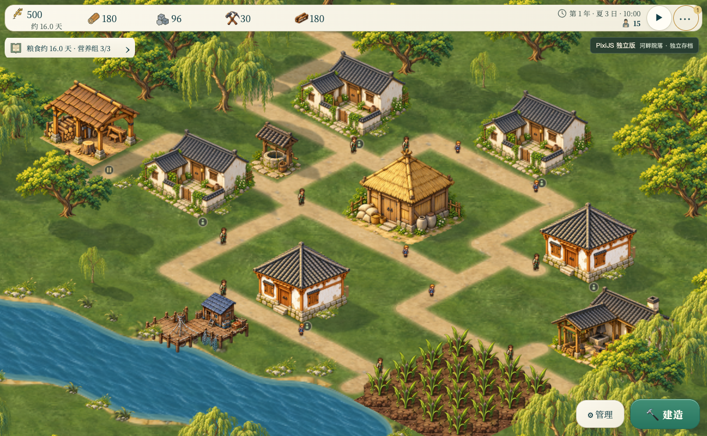
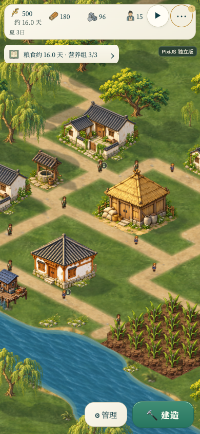
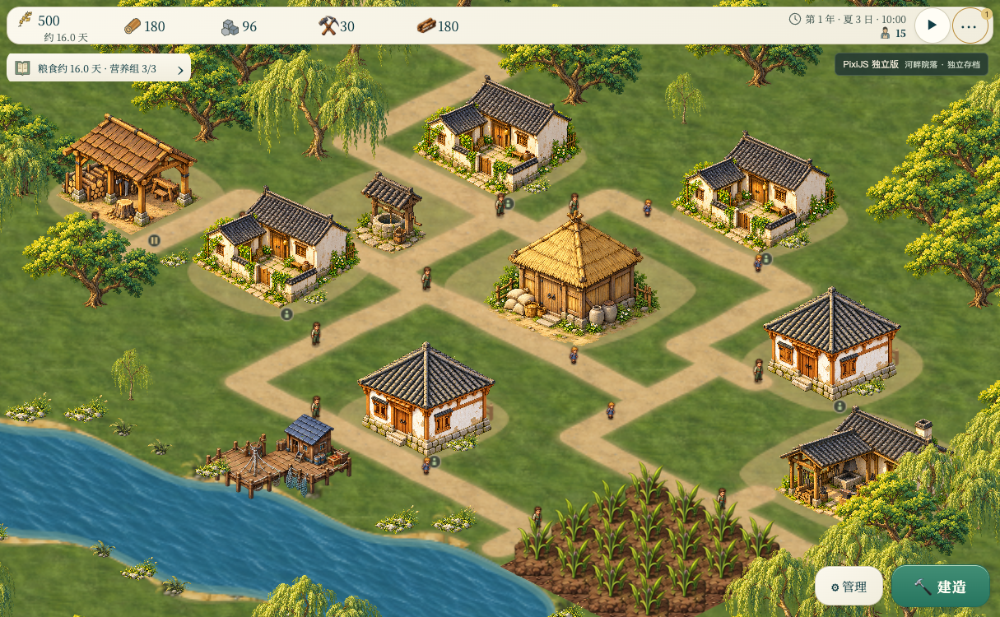
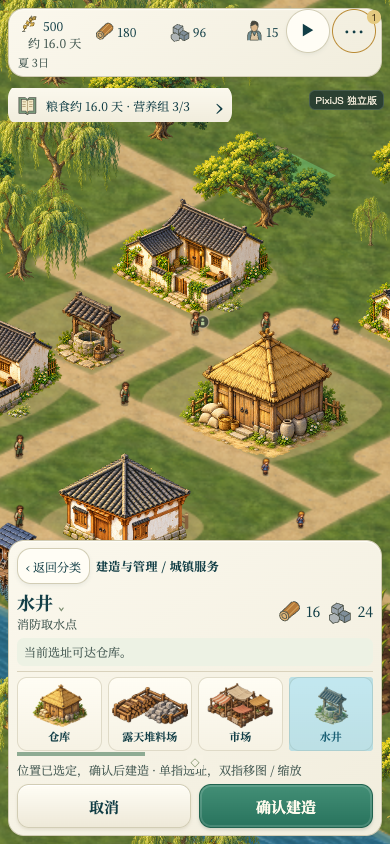

# PixiJS 独立版 · 青玉河湾村

入口为 `pixi.html`，分支为 `codex/pixijs-standalone`。在本工作树根目录运行：

```sh
python3 dev-server.py 8624
```

打开 <http://127.0.0.1:8624/pixi.html>。首次进入载入青玉样板村，并暂停模拟；右上角 ▶ 继续经营。<http://127.0.0.1:8624/pixi.html?start=classic> 保留普通开局入口。原 `index.html` 仍使用 Canvas 2D。

2026-10-24 新增可玩的美术切片：<http://127.0.0.1:8624/pixi.html?scene=courtyard>。它独立载入 `assets/pixi/courtyard-village.json`，本机存档前缀为 `banish_pixi_courtyard_`，不会重置前一版河湾村的进度。用 `node tools/build-pixi-village.cjs courtyard` 重建切片。包含真实的 13 栋建筑、5 户、15 位居民，采集和护林设施位于主景外。道路、家庭、岗位、农田和搬运继续使用现有规则。

这一轮按 A 图统一了粮仓、水井和铁匠铺的灰瓦、木材、石材与暖光；民居混用院落和既有小型四坡屋顶，降低重复。建筑使用源像素锚点与统一生活尺度，放置预览沿用相同尺寸。居民围绕原脚点放大 20%，不改变真实位置或运动速度。后侧小段围栏位于不可通行的建筑占地内；河岸石草缩小并稀疏分组。

`js/pixi-ground.js` 根据真实土路格的邻接绘制连续土路，使用原始不透明土纹理、渐淡肩缘和确定性的非对称院落边缘，并复用地形缓存与脏区修补。石路和冬季保留原表现。贴花遮罩排除水面、岩石、山体与石路；不会改道路、碰撞或存档数据。贴图加载失败时回退土色，建筑素材缺失时回退原素材。

这仍是美术切片：人物、作物、草地和水面大多沿用原素材，尚未达到 A 图的完整细节与场景密度。

### 阴影与材质修正

`js/pixi-shadows.js` 为院落、小民居、粮仓、水井、铁匠铺和伐木棚制作了独立的地面投影遮罩。低模顶点按源图的石基、立柱、屋檐与屋脊校准，记录图像坐标和独立的竖直高度；地面点保持原位，高处沿统一右下光向投到地面。院落分主屋、厢房与矮墙，井亭保留屋顶和立柱之间的空隙，不使用逻辑占地生成大块底影。树木以树干、分枝和椭球树冠投影近似，冬季移除树冠。

遮罩按实际投影范围留足边缘，每类素材只生成一次，添加约 1–2 世界像素的柔边，复用原图绘制矩阵对齐。所有可见投影先以不透明遮罩合并，再由 Pixi AlphaFilter 统一施加 .32 透明度，重叠处不会重复加深。滤镜范围使用相机反变换后的本地视口坐标；直接传屏幕矩形会在本版本 Pixi 中被再次变换而跳过滤镜。投影位于地面之上、场景物体之下，离屏对象和世界切换沿用对象清理流程，静止帧不上传新遮罩。

制作依据：[Sweet Transit 开发者的独立阴影层说明](https://www.gamedeveloper.com/programming/deep-dive-designing-sweet-transit-and-the-unique-challenges-of-programming-in-2d)、[Factorio 的树影分层与重叠合并](https://www.factorio.com/blog/post/fff-227)、[Microsoft 的平面阴影投影](https://learn.microsoft.com/en-us/windows/win32/api/directxmath/nf-directxmath-xmmatrixshadow)。当前是固定光向的地面投影近似，未制作物体之间的投影和精细树叶遮罩；其它未校准建筑保持原表现。

大于等于 256 像素的静态图像启用一次性 mipmap，减少 1536 像素源图降至游戏尺寸时的瓦片与树叶采样碎点；动态 Canvas 分段维持原缓存方式。接口依据是 [PixiJS TextureSource 文档](https://pixijs.com/8.x/guides/components/textures)，在当前固定的 8.22.0 WebGL 后端确认大图具有 11 级 mip。

夏季草地纹理从八格调整为十六格连续采样，土纹理从四格调整为十二格，让源纹理细节在受预算限制的地面缓存中保留；道路肩缘复用同一真实土材质，停止夏季建筑外扩的统一土色底垫。原素材继续保留，冬季和其它季节的地面路径不变。院落民居改用哑光版本，素材与逐字生成提示词见 `assets/pixi/README.md`。

这些是二维素材与采样修正。尚未制作法线、粗糙度或实时三维光照。没有按逻辑占地统一画 AO 外框，因为井、粮仓等素材实际底座小于占地，外框会露在基脚之外。

投影验证：修改脚本语法、差异空白检查通过。桌面 Chromium WebGL 加载 13 栋建筑、15 位居民；暂停连续渲染前后序列化结果一致，静止帧无分段纹理上传。可见投影数与节点数均为 134，移出画面为 0、移回恢复 134。同一暂停镜头开关投影，四处建筑／树旁草地样点的像素亮度降低约 19–20%，非阴影路面样点不变。390×844、DPR 2 渲染为 780×1688，无横向溢出；两种尺寸的页面与 WebGL 错误均为 0，素材无加载失败。未重复运行前轮模拟测试，本次仅改独立入口的渲染。







切片本轮验证：既有 257 项测试通过；两种生成模式的存档、家庭、居民起点和建筑可达性断言通过。Chromium WebGL 中，新水井工具卡与选址预览加载正确，确认后由 13 栋增至 14 栋真实工地；推进约 5 游戏小时后出现 6 个真实岗位和工作／走路状态；存档通过校验，刷新恢复正确。单次暂停绘制前后序列化数据一致，原版及前一版河湾存档键未变化。截图前恢复为作者初始的 13 栋村落。

390×844、DPR 2 模拟下，无横向溢出，触控选址与取消通过；取消后仍为 13 栋。最终页面错误与素材加载失败均为 0。此轮未做真机性能或所有天气场景验收。




## 美术与场景

以 [A 图](../ui-reference/selected-a.png) 的白墙灰瓦、暖色粮仓、柳树、河岸石草和纸色青玉界面为方向。新增透明院落与河岸组合素材，保留源图，用源像素锚点校准落地位置。建筑工具卡和放置预览使用对应素材；低矮装饰参与深度排序。院落地表贴花烘焙进地形缓存，跨格连续绘制。

样板村是作者布置的**可玩初始存档**，含 13 栋建筑、5 个家庭、15 位居民、已播农田和较充足的初始库存。它不是自然游玩到夏季的记录，也不是整幅背景画。建筑、作物、道路和树木仍属于游戏世界，居民使用现有寻路、岗位、搬运和生产系统。

布局来源是 `assets/pixi/village-plan.json`。修改布局后用 `node tools/build-pixi-village.cjs` 重建 `assets/pixi/river-village.json`；生成器通过正常建筑放置接口建村，并验证存档、家庭与建筑可达性。运行时通过原来的存档校验入口载入，不在渲染循环里伪造居民路线或产量。普通开局的物资和规则保持原有定义。

这是朝 A 图收敛的第一版实际场景。现有井、部分工坊与其他未替换建筑仍沿用原素材，未逐像素复刻 A 图的完整村落。

## 渲染实现与依据

PixiJS 8.22.0 固定版本，MIT 许可，包与许可保存在 `js/vendor/`，启动不依赖 CDN 或构建工具。

- 地形：沿用已经存在的连续草地、岸线和脏区缓存，分成最大 2048×2048 的 GPU 纹理。
- 场景：普通图像绘制转为原生 Pixi Sprite，共享源纹理、摄像机 Container 和现有落地点排序。
- 兼容绘制：现有矢量、裁剪与阴影保留 Canvas 语义，按对象分段缓存；未变化的分段不重复上传。它是本项目的迁移桥接层，不是通用 Canvas 实现。
- 地面工具提示与天气等效果仍用两个透明 Canvas 图层。当前不是所有效果都已改为原生 Pixi 绘制，也不承诺比原版在所有设备上更快。
- 输入和模拟：沿用游戏现有的 DOM 输入、寻路、经济与唯一主循环。关闭 Pixi 的重复事件命中检测，异步 GPU 初始化完成后再初始化布局。

采用这些做法前核对的原始资料：

- [PixiJS Scene Graph](https://pixijs.com/8.x/guides/concepts/scene-graph)：Container 变换、Sprite、绘制顺序。
- [PixiJS Performance Tips](https://pixijs.com/8.x/guides/concepts/performance-tips)：纹理复用、静态内容缓存、避免不必要的 Canvas 上传。现阶段复用已有独立素材；待测量证明需要时再做图集。
- [PixiJS 8.22 Events](https://pixijs.download/v8.22.0/docs/events.html)：事件功能开关；同时核对了所固定 npm 包内的 EventSystem 源码。
- [Tiled 图层手册](https://doc.mapeditor.org/en/latest/manual/layers/)：地形与自由放置对象分层；本版用现有 JSON 数据和存档实现作者布景，无需另引入编辑器运行时。

## 存档隔离

| 入口 | 本机键前缀 |
| --- | --- |
| 原版 `index.html` | `banish_` |
| 青玉样板村 | `banish_pixi_village_` |
| Pixi 普通开局 | `banish_pixi_` |

两种 Pixi 入口各自保存手动档、自动档和恢复备份。关闭 Pixi 入口的服务器存档接口，避免共享原版服务器自动档。需要跨入口迁移时使用文件导出／导入；既有存档结构不变。首次进入普通开局后，也可用原来的新村设置选择难度、地形、尺寸和气候。

## 本轮验证

- `node tools/build-pixi-village.cjs`：可玩样板存档、家庭和建筑可达性断言通过。
- `node tests/farm-occlusion.js`：9 项通过。旧夹具原先没有完成现行施工流程，现改用真实的立即建成接口，并跟踪 A 风格住房绘制。
- `node tests/citizen-presentation.js`：22 项通过。
- `node tests/smoke.js`：226 项通过。
- Chromium 桌面：地图选址、确认建造产生真实工地、退出工具、推进约 6 游戏小时、存档校验及刷新恢复通过；原版本机存档键未变化。
- Chromium：山地与 192 格地图成功渲染，地形纹理不超过 2048 像素，无页面错误；原 `index.html` 仍使用 CanvasRenderingContext2D，启动无错误。
- 390×844、DPR 2 手机模拟：无横向溢出，双指移图缩放、单指选址、取消待建位置通过。这是设备模拟验证，未做真机性能验收。


