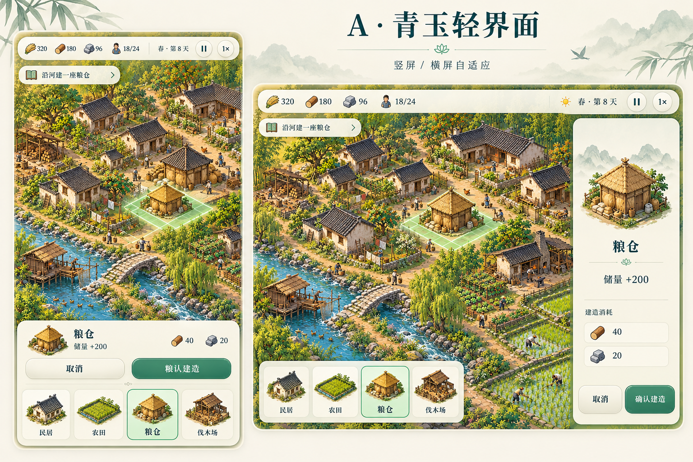

# A · 青玉轻界面：持久参考与对照验收

## 来源与身份

这是此前生成并由用户选定的 **A · 青玉轻界面** 原始概念图，现随仓库保存为 UI 标定参考。2026-10-21 已实际查看原像素，并核对原生成文件、早期 A 对照文档内嵌图与保留的原图副本字节一致；本次未生成、重画、裁切、缩放或重新编码。原生成任务提示词未随此文件保存，不据此臆造。

- 文件：`selected-a.png`，PNG，1536 × 1024，3,215,680 bytes。
- SHA-256：`cad13e5d332baa8358faf837e8160ffd6aafb9dfdebc321d506f8c696702cb97`。
- 这是设计概念图，**不是游戏运行截图，也不是验收通过证明**。图内示例数字、文字及建筑容量不定义玩法参数；字体具体名称和精确色值未从源图恢复。
- 持续跟踪：[Issue #87](https://github.com/LukeJiaoR/banish/issues/87)。UI 实现与检查：[PR #119](https://github.com/LukeJiaoR/banish/pull/119)、[桌面工作区记录](../desktop-workspace.md)。#86 仅是已交付的分类卡修正，不等于 A 整体验收。

## 对照合同与有意适配

A 的共同结构是地图优先、紧凑顶部资源条、小型引导条、暖象牙纸色表面、深青字、青玉主操作和完整建筑插画。选中建筑按「图像/名称与用途 → 成本 → 取消/确认」分层。竖屏把选择摘要、操作和目录收在底部；横屏将详情放右侧、快捷目录放左下。

**后续用户反馈要求避免跨屏两侧操作，因此当前桌面实现有意把完整建造目录、选中摘要及确认/取消统一到右侧工作区。** 不应为了机械复制 A 把目录搬回左下。手机保留底部托盘；矮屏可压缩插画与间距，但不能裁切操作或消除信息层级。A 仅示意四个快捷项目；实际目录必须保留全部 34 个现有工具（31 个可建造定义加 3 个地图操作），不能为相似度删功能。

## 尚待真实浏览器完成的 A 对照清单

以下均保持未勾选：已有实现或离线测试，不自动构成最新版本的视觉/交互验收。

- [ ] **整体布局**：地图保持主体，顶部资源条及引导不遮盖选址；桌面完整右侧工作区、竖屏底部托盘、矮屏滚动均可读可用。记录相对 A 的有意布局差异，不声称逐像素复刻。
- [ ] **材质与文字**：暖象牙纸色、深青标题、青玉主按钮、边框与阴影层级协调；实际加载中文字体，数字与说明可读。选中/不足/禁用状态清楚，不只靠颜色辨认。
- [ ] **选中信息层级**：真实建筑图、名称/用途、可见资源成本及成对操作明确；窄屏不因压缩丢掉成本/确认，详情可展开并返回，展开内容不被裁切。
- [ ] **完整目录与同侧流程**：逐类滚动并实际点击全部 34 个工具，首末项可达、名字可读；返回分类、切换工具、关闭/重新打开工作区正常，桌面选择到确认无需跨到另一侧找操作。
- [ ] **真实建造语义**：无效位置有原因；有效位置显示真实预览；确认只创建一次工地，取消不创建；重复点击、键盘中断、焦点丢失及恢复无误建或卡死。按真实成本/库存显示，不照抄 A 的示例数字。
- [ ] **特殊工具及现有功能**：道路四种表面切换/取消、墓园可变规划、管理与资源明细入口均可用；不能以普通建筑流程的通过替代这些检查。
- [ ] **响应式与输入**：1440×900、1024×640、1280×600、390×844、844×390 及现有重排矩阵检查滚动、命中、焦点和遮挡；另复查 360×640。真实浏览器缩放、触控及物理手机验证单独记状态，不把 iframe/窄 Canvas 当真机。
- [ ] **证据绑定版本**：每轮保存实际运行 commit/served-source hashes、视口、选中建筑与资源状态、完整截图及 UI 局部对照。保留原图纵横比，区分全场景差异和 UI 差异，人工查看像素后再逐项更新结论。

## 实现、离线验证、浏览器验收分别记录

截至 2026-10-21，本记录基于 main `1340ee0`：

- **已实现并合并**：#119 在 `5710d96a93aa159e9ae67b799761f5924adb7962` 普通合并，含右侧工作区、34 工具目录、道路/墓园显示修正、手机详情裁切和键盘中断修复。
- **已有离线验证**：#119 最终记录 11 组定向测试套件通过；Jade 31 组、目录 34 工具/16 道路组合等为 DOM/结构/模拟证据。其浏览器 runner 已准备并作静态检查，场景未执行。不是全游戏测试通过。
- **尚未通过**：该版新 PC 截图、A 布局相似度、真实浏览器命中及手机验收。旧截图与旧 34 工具浏览器报告早于恢复分支及修复，只能作历史证据。既有环境报告 localhost 不可达、file 预览被策略拒绝，未绕过。
- **合并和验收分开**：用户于 2026-10-21 明确 PC/视觉验收不阻断普通合并；这不等于 A 对照或 #87 已完成。本次仅归档原图及验收合同，没有运行浏览器或新增游戏截图。

可用预览具备条件后，现有 `tests/ui-ux-browser.cjs` 的 `--reference docs/ui-reference/selected-a.png` 可把原图加入对照报告；自动断言不能代替上述人工像素检查。旧报告不能冒充新版本证据。

## 场景美术另行对照

A 的完整画面还包含白墙深瓦、稠密江南村落、暖黄植被和河岸经营构图。当前早期优质房屋、树、人及暖色手绘材质体系与之存在明显差异；UI 改造不能证明整幅场景已像 A，也不授权为了统一而重画已有优质资产。

场景继续按 #87 原范围与[暖色手绘 brief / 实际尺度样板](../art-assets/warm-scene/README.md)检查轮廓、光照、材质层级、地表重复、岸线和夏冬一致性；其离线 Canvas 对比独立于 HUD/浏览器验收。后续更新须说明实际修复的场景项，不能以本文件归档或 UI 合并关闭整体美术目标。
