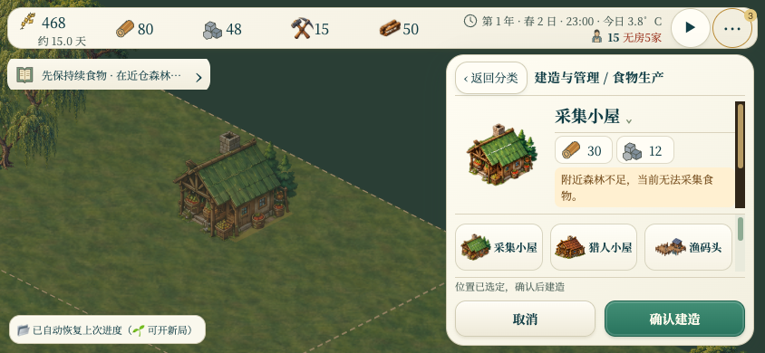
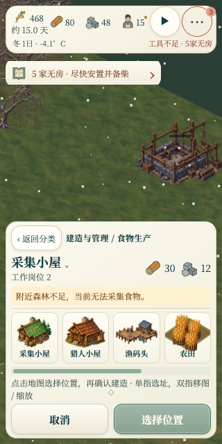

# UI / UX 修复验收 · 2026-10-24

基线 `main / 7ea3dad`。三个子 agent 分别完成选址反馈、触摸相机和响应式样式，主 agent 合并 HUD 与帮助文案，并进行浏览器验收。

- 选址主卡片显示森林不足、水域低产、无鹿群或仓库不可达的简短提示，完整评估保留在展开说明。确认建造仍只创建工地。修正说明折叠后被旧焦点样式重新打开的问题。
- 选中工具时可双指移图与捏合缩放；沿用相机范围。进入双指手势时清除未确认预览，保留工具；剩一指继续移动不会误建或提交采运。
- 桌面常显食物、木材、石头、工具和柴火；手机的工具、柴火仍可在“更多”查看。断点切换复用原库存节点。自动供给显示食物估算天数，逐户配送显示“公共库存”，避免混淆家庭现货。
- 手机常显季节日期、气温及燃料、工具、住房风险名称；地图操作指引恢复可见。燃料沿用生存清单阈值，个人工具模式按实际装备判断。
- 短屏选项卡改为 52px 横向图文，列表保留至少 64px；展开说明不再把标题推到滚动区上方。
- 校正矿井有限储量、住房耗柴、学校转校/保留学籍及触屏操作说明。

## 验证

主 agent 使用 Node 24.14.0，通过 jade-layout-ui（43组）、jade-resources-ui、desktop-workspace-ui（5组）、mobile-occlusion、navigation-ui（10组）、dynamic-onboarding（14组）和 build-affordance-ui（15组）。子 agent 的选址、建造确认、渔业、鹿群、礼拜堂与触控输入定向回归通过，其中触控相关测试共232组。JS 语法与 `git diff --check` 通过。

实际 Chromium 浏览器验收覆盖 1227×763、390×844、320×640、844×390：五项库存/口粮天数、低产提示、详情展开与收起、“更多”库存、确认仅创建一个工地、窄屏日期和具名提醒、完整卡片名称及按钮均通过。双指操作使相机缩放从1变为1.1667，页面缩放保持1；松一指继续移动后，建筑数、采运标记不变，工具保留，未确认预览清除。脚本错误记录为空。

`hud-guidance-ui.js:166` 仍失败：旧断言认为石屋冬季剩13.75柴火无需提醒，现有规则约需19。已在未修改的 `HEAD` 临时副本复现相同失败，本轮未改动取暖规则或放宽断言。

本次触摸与视口验收采用 Chromium 模拟，未做真机 Safari 验收。

