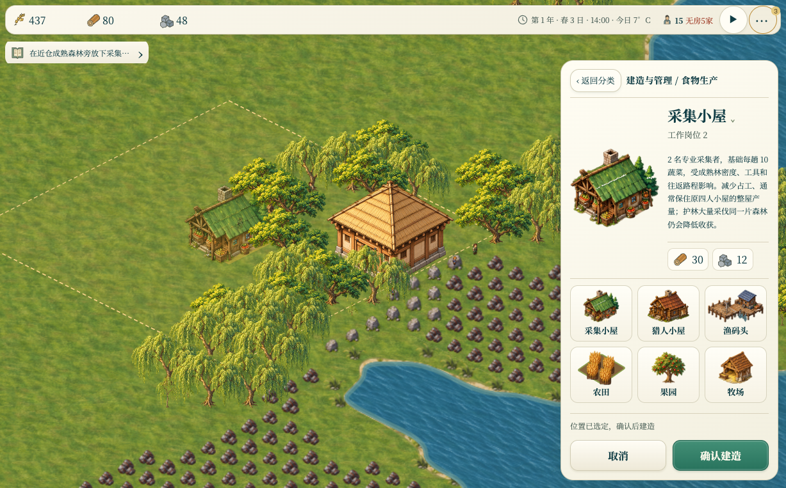
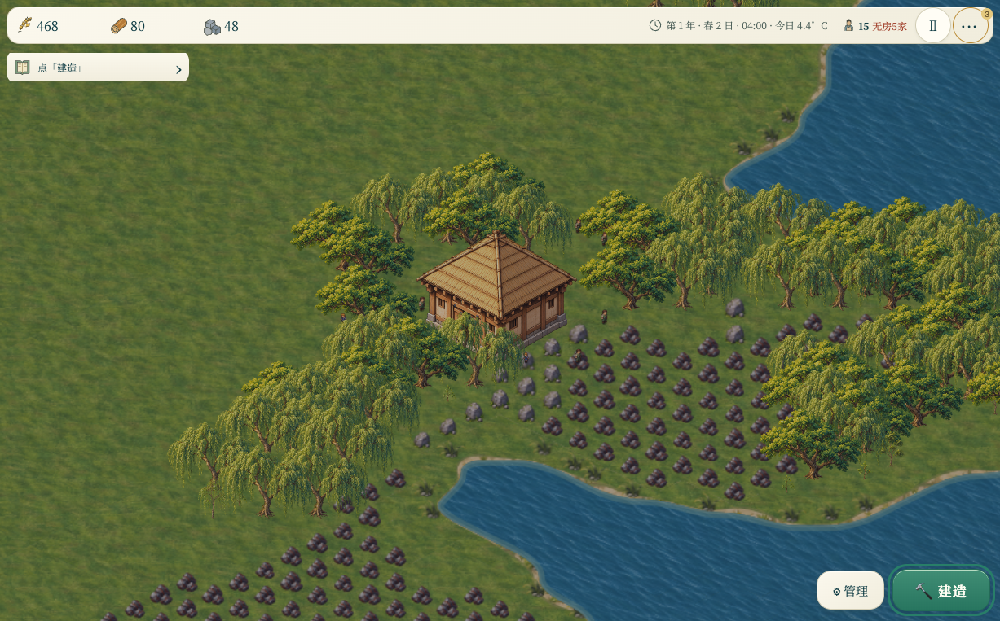
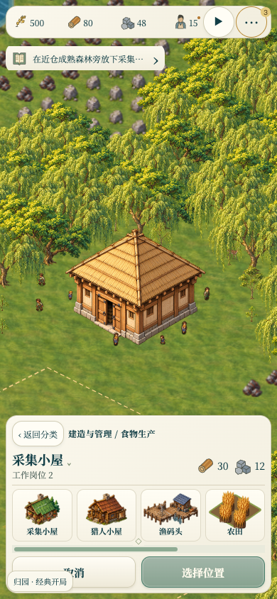
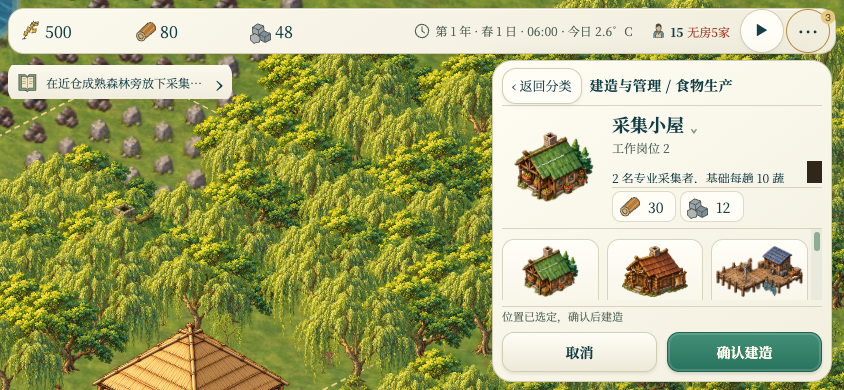

# Banish UI / UX 审查 · 2026-10-23

审查基线：`main` / `7ea3dad`，由 `000149b` 快进更新，共 31 个提交。审查没有修改游戏代码。

实测尺寸：桌面 1227×763、手机竖屏 390×844、手机横屏 844×390。通过本地静态服务器运行，核对真实界面、DOM 样式和输入处理。手机为 Chromium 尺寸与触摸事件模拟，未做真机 Safari 验收。

## 判断

纸色面板、青绿色操作按钮和林地场景已有一致的视觉方向。桌面的建造分类、确认建造和建筑详情也已有明确结构。当前优先级应放在经营信息可见性、移动端地图操作和过期说明，不需要重新设计整套皮肤。

共 6 项 P2。选址反馈最初评为 P1，讨论后下调：它影响建造决策，但不阻断建造。主卡片应给出简短的适宜性提示，完整数据留在展开详情。

## 1. P2 · 普通建筑的选址评估被永久隐藏

**复现**：建造 → 食物生产 → 采集小屋，移动或点击森林边缘的有效位置，再展开建筑名称旁的详情。

**实测**：系统已经生成“成熟 17 棵”“林量偏低，充足参考 24 棵”“可达仓约 3 步”等评估，但 `#placement-info` 的计算样式仍为 `display: none`。展开后只显示静态建筑说明；主卡片仅有“工作岗位 2”和成本。确认按钮可以正常建造，因此玩家会在没有看见低产警告的情况下确认位置。

**位置**：`styles/jade-layout.css:93` 对 `data-ordinary=true` 的建筑直接隐藏选址信息；`js/jade-layout.js:83`、`:87` 只补了岗位和是否合法的简要状态，没有接回产能、林量及运输评估。

**最小建议**：主卡片常显当前选址最重要的一条自然语言评估，例如“附近成熟林偏少，采集产量较低”；展开详情保留完整选址说明。复用现有 `G.placementInfo` 的计算。

## 2. P2 · 手机选中工具后无法移图，也没有游戏内触摸缩放

**复现**：390×844 下选择采集小屋，在地图空白区域单指拖动；再尝试双指放大。

**实测**：两次操作前后的相机都为 `{ x: 579, y: -1178, z: 1 }`。单指平移在存在 `G.tool` 时被禁用；多指事件不参与相机控制；游戏缩放只接了鼠标滚轮，界面没有缩放控件。

**影响**：窄屏可见地图有限。寻找河岸、森林或屏幕外的选址时，必须取消工具、移图、重新选择工具；道路和采运选区也无法边选边移动。双指操作不能调整游戏视野。

**位置**：`js/main.js:1951`、`:1953`、`:2083`。

**最小建议**：让双指拖动始终承担平移，保留单指选址/框选；增加触摸缩放或两个明确的缩放按钮，继续使用现有相机范围。避免为此改动建造和资源规则。

## 3. P2 · 顶栏把关键经营指标收得过深

**实测**：桌面和手机顶栏都只常显食物、木材、石头。柴火与工具被移到“···”；食物净变化被隐藏，食物可撑天数主要在悬停说明或折叠的生存清单中。初始界面的“3”提醒没有直接说明是哪三项。

**影响**：玩家容易只看库存绝对值，无法持续判断粮食正在减少多少、柴火能否过冬、工具是否接近耗尽。现有提醒计数和动态引导提供了补偿，但仍需要展开或悬停才能理解具体压力。

**位置**：`js/jade-layout.js:20`、`:21`；`styles/jade-layout.css:11`、`:25`。

**最小建议**：桌面保留柴火和工具；食物旁显示库存折算天数。手机至少让紧急资源的名称和缺口直接出现，其余资源继续留在“更多”。沿用当前库存口径，并保留“不计新产出”等必要说明。

## 4. P2 · 手机主界面看不到季节、日期和气温

**复现**：在 390×844 主界面观察顶栏。

**实测**：`#date` 在 ≤760px 时直接隐藏；人口旁的无房文字也被缩成小圆点。日期和气温虽被复制到“更多资源”底部的人口健康明细，主界面没有对应的常驻读数。

**影响**：季节、霜冻和剩余备冬时间直接决定种收与住房安排。玩家需要反复展开资源面板才能确认当前时间，尤其不利于手机上的快速决策。

**位置**：`styles/jade-layout.css:110`、`:116`；`js/jade-layout.js:118` 的人口健康明细更新。

**最小建议**：常显一行紧凑时间，例如“春 1 日 · 3°C”，在紧急状态显示“5 家无房”而不是仅显示圆点。完整年月、时刻与人口健康仍可折叠。

手机还有一个相关的小问题：`styles/jade-layout.css:31` 把 `#toolbar-state` 裁成不可见区域，桌面样式才重新显示。因此“点击地图选择位置，再确认建造”在手机上不可见。可在同一轮信息可见性修复中恢复这一行。

## 5. P2 · 横屏展开建筑说明后，列表连一张完整卡片都放不下

**复现**：选择采集小屋，展开名称旁的建筑说明，再切换到 844×390。

**实测**：选项滚动区高度约 72px，而每张卡片固定为 88px。首排只能看到建筑图，名称在区域底部被裁切；滚动后才能露出文字。展开的说明本身也需要在小区域里滚动。

**影响**：玩家不能同时识别建筑图和名称，菜单中出现多个局部滚动区域；缩短窗口就损失了基本的识别能力。

**位置**：`styles/desktop-workspace.css:40` 固定卡片高度；`:67`、`:70`、`:117` 的短屏布局没有为完整选项行预留足够空间。

**最小建议**：短屏优先压缩所选建筑插图及说明区，确保列表至少露出一整排“图 + 名称”；或者使用更矮的横向图文选项。保持当前返回和确认按钮的位置。

## 6. P2 · 游戏内帮助仍在解释旧规则

**复现**：管理 → 帮助 → 操作与生存手册。

| 帮助文案 | 当前规则 |
| --- | --- |
| 矿井“不受矿藏限制的可持续来源” | 新矿井共用有限储量，最多 3500 铁或 7000 煤；开采后拆除永久留坑 |
| 石屋“省一半柴火” | 基准木屋 30、石屋 20，同日需求为木屋的 2/3，即省三分之一 |
| 教师离职时“学生辍学” | 优先转校；无处可去则保留学籍和课时等待，永久结束学业需确认 |

**影响**：这些说明会改变玩家对资源可持续性、住房回报和教育中断的判断，不属于纯措辞问题。

**位置**：`index.html:134`、`:135`、`:137`；可对照 `js/defs.js:96`、`:58`、`:209`。

**最小建议**：直接校正这三处帮助文字，并明确新村/旧档差异。无需扩大到帮助系统重构。

## 验证范围

已走通：打开新村、暂停、两级建造菜单、选择位置并确认创建工地、查看工地详情、取消工具、展开更多资源、管理入口、新局设置后取消、帮助面板和基本 Escape 返回。桌面审查页的脚本错误记录为空。

本次没有修改业务逻辑，也未运行整套经济模拟回归。截图均来自本次运行；触摸问题同时核对了浏览器触摸事件前后的相机状态和输入处理代码。

建议修复顺序：选址反馈 → 手机地图操作 → 关键经营与日期信息 → 横屏菜单 → 帮助文字。保留当前视觉方向，以现有组件的小范围调整完成。
